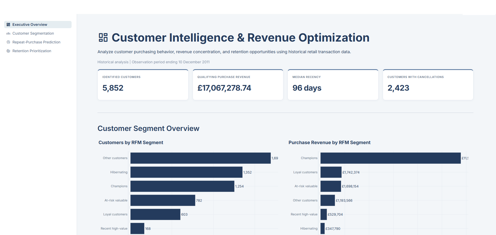
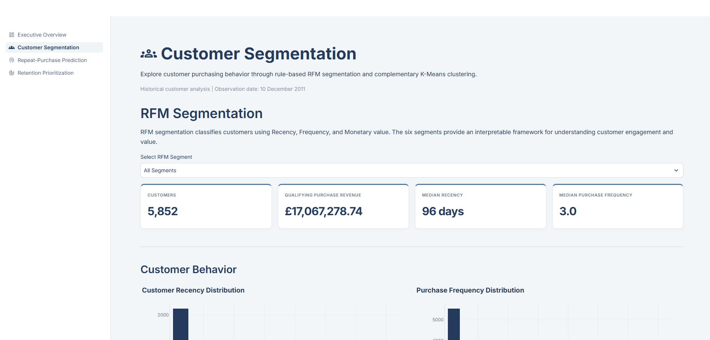
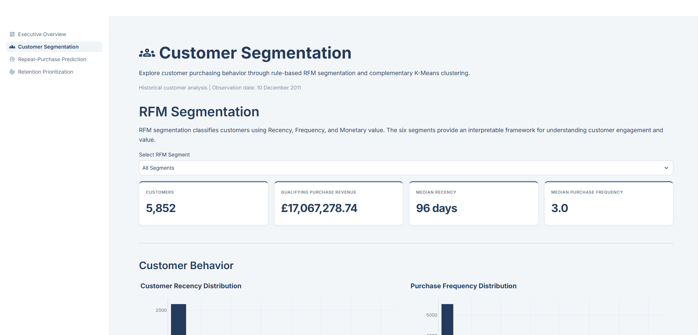
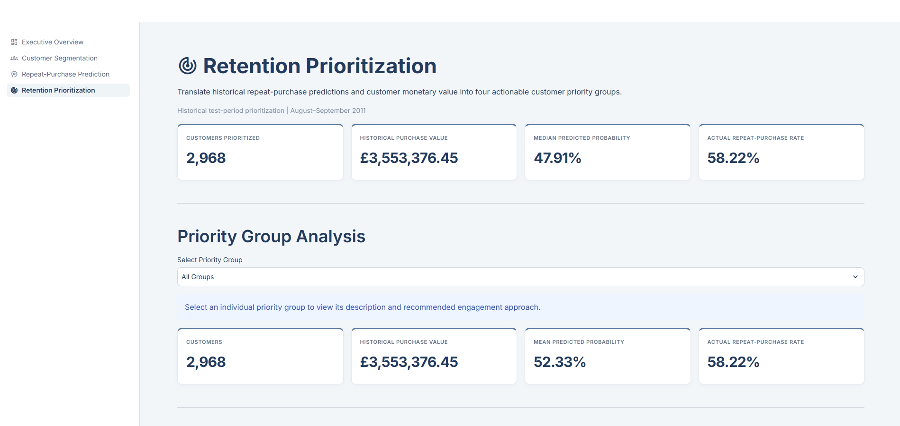

# Customer Intelligence & Revenue Optimization

**An end-to-end Data Science project transforming retail transaction data into customer insights, repeat-purchase predictions, and actionable retention priorities.**

[](https://customer-intelligence-revenue-optimization.streamlit.app/)
[](https://www.python.org/)
[](https://www.postgresql.org/)
[](https://scikit-learn.org/)

**[Explore Live Application](https://customer-intelligence-revenue-optimization.streamlit.app/) · [Technical Documentation](docs/PROJECT_DOCUMENTATION.md)**

---

## Project Overview

How can a retailer identify valuable customers, anticipate future purchasing behavior, and prioritize customer engagement?

This project develops an end-to-end customer analytics solution using historical retail transaction data. It combines data engineering, exploratory data analysis, customer segmentation, predictive modeling, and business-oriented prioritization.

A Logistic Regression model estimates the probability that an eligible customer will make another purchase within the next 90 days. These predictions are combined with historical customer monetary value to create four retention priority groups.

The results are delivered through an interactive Streamlit application.

## Technical Highlights

| Technical Area | Methods & Technologies |
|---|---|
| **Data Engineering** | ETL, Data Cleaning, Data Transformation, Data Validation |
| **Exploratory Data Analysis** | EDA, Statistical Analysis, Revenue Analysis, Customer Analytics |
| **Database Engineering** | SQL, PostgreSQL, Relational Database Design |
| **Unsupervised Learning** | RFM Analysis, K-Means Clustering, Silhouette Score |
| **Feature Engineering** | Customer Snapshot Construction, Log Transformation, Temporal Features |
| **Supervised Learning** | Logistic Regression, Binary Classification, Probability Prediction |
| **Model Evaluation** | ROC-AUC, PR-AUC, Precision, Recall, F1-score, Calibration |
| **Business Analytics** | Customer Segmentation, Retention Prioritization, Business Insights |
| **Application Development** | Streamlit, Plotly, Model Persistence, GitHub Deployment |

## Project at a Glance

| Dimension | Result |
|---|---:|
| Original transaction records | 1,067,371 |
| Cleaned transaction records | 1,033,036 |
| Exact duplicate records audited | 34,335 |
| Customers segmented | 5,852 |
| Customer-snapshot observations | 47,933 |
| Selected predictive model | Logistic Regression |
| Test ROC-AUC | **0.7413** |
| Test F1-score | **0.7026** |
| Customers in retention prioritization | 2,968 |

## Application Preview

Explore the four interactive components of the deployed application.

### 1. Executive Overview

High-level business metrics, revenue patterns, and transaction insights.



### 2. Customer Segmentation

Explore RFM customer segments, customer profiles, and complementary K-Means clusters.



### 3. Repeat-Purchase Prediction

Explore predictive model performance, classification thresholds, and customer-level predictions.



### 4. Retention Prioritization

Explore P1–P4 customer groups, prioritization scenarios, and customer-level information.



**[Launch the Live Streamlit Application →](https://customer-intelligence-revenue-optimization.streamlit.app/)**

---

## Key Business Findings

### 1. Revenue Concentration

- Net merchandise revenue: **£18.92 million**.
- The United Kingdom contributed **85.42%** of net merchandise revenue.
- The five largest countries accounted for **95.02%** of revenue.
- The top 100 products contributed **28.96%** of revenue.

These findings highlight substantial geographic and product revenue concentration.

### 2. Customer Segmentation

RFM analysis identified six customer segments across 5,852 customers.

| Customer Segment | Customers | Revenue Contribution |
|---|---:|---:|
| Champions | 1,254 | 67.71% |
| At-risk valuable | 782 | 9.95% |
| Loyal customers | 603 | 10.21% |
| Hibernating | 1,352 | 2.04% |
| Recent high-value | 168 | 3.10% |
| Other customers | 1,693 | 6.99% |

The Champions segment represents the largest share of historical customer monetary value.

The At-risk valuable segment provides another important area for investigation: customers with substantial historical value who have not purchased recently.

K-Means clustering was also evaluated as a complementary segmentation approach, producing four clusters with a silhouette score of **0.3614**.

### 3. Repeat-Purchase Prediction

The selected Logistic Regression model achieved the following test results:

| Evaluation Metric | Test Performance |
|---|---:|
| ROC-AUC | **0.7413** |
| PR-AUC | **0.8139** |
| Accuracy | 0.6765 |
| Precision | 0.7555 |
| Recall | 0.6565 |
| F1-score | **0.7026** |

The model estimates the likelihood of a qualifying repeat purchase within 90 days.

### 4. Retention Prioritization

Predicted repeat-purchase probability and historical monetary value were combined to classify 2,968 unique customers into four groups.

| Priority | Customer Profile | Customers | Historical Monetary Value |
|---|---|---:|---:|
| P1 | High value, low propensity | 228 | £159,677 |
| P2 | High value, high propensity | 1,256 | £3,043,099 |
| P3 | Low value, low propensity | 1,256 | £275,588 |
| P4 | Low value, high propensity | 228 | £75,012 |

**Business interpretation:**

- **P1:** Candidates for targeted retention investigation and outreach.
- **P2:** Valuable customers whose purchasing relationships may benefit from continued engagement.
- **P3:** Candidates for lower-cost or automated engagement.
- **P4:** Candidates for efficient nurturing and monitoring of future value.

These groups provide a structured decision-support framework rather than a measurement of actual campaign effectiveness.

---

## Methodology

The project follows an end-to-end Data Science workflow:

1. **Business Understanding:** Define business questions and analytical objectives.
2. **Data Acquisition & Assessment:** Examine the UCI Online Retail II dataset and assess its suitability.
3. **ETL & Data Quality:** Extract, clean, classify, transform, and validate transaction records.
4. **Database Engineering:** Structure transaction data and reference tables in PostgreSQL.
5. **EDA:** Investigate revenue concentration, purchasing patterns, and transaction behavior.
6. **Customer Segmentation:** Apply RFM analysis and K-Means clustering.
7. **Feature Engineering:** Construct customer snapshots using a 180-day historical observation window.
8. **Predictive Modeling:** Estimate repeat-purchase propensity over a 90-day horizon.
9. **Model Evaluation:** Assess discrimination, classification performance, and probability calibration.
10. **Business Prioritization:** Combine model predictions with historical monetary value.
11. **Application Development:** Deliver analytical results through an interactive Streamlit application.

## Technology Stack

| Area | Technologies |
|---|---|
| Programming | Python |
| Data Manipulation | Pandas, NumPy |
| Database | PostgreSQL, SQL |
| Visualization | Plotly |
| Machine Learning | scikit-learn |
| Model Persistence | Joblib |
| Application | Streamlit |
| Data Formats | CSV, Parquet |
| Development | Jupyter Notebook, VS Code, Git, GitHub |

---

## Dataset

**Source:** Chen, D. (2012). [Online Retail II — UCI Machine Learning Repository](https://doi.org/10.24432/C5CG6D).

The dataset contains historical transaction records from a UK-based non-store retailer, covering December 2009 through December 2011.

The dataset is distributed under the [Creative Commons Attribution 4.0 International License (CC BY 4.0)](https://creativecommons.org/licenses/by/4.0/).

---

## Project Structure

```text
customer-intelligence-revenue-optimization/
│
├── app/
│   ├── Home.py
│   ├── config.py
│   ├── pages/
│   ├── components/
│   └── utils/
│
├── data/
│   ├── raw/
│   ├── processed/
│   └── reference/
│
├── docs/
│   ├── PROJECT_DOCUMENTATION.md
│   ├── images/
│   ├── data_cleaning_and_etl.md
│   ├── exploratory_data_analysis.md
│   └── customer_analytics_and_segmentation.md
│
├── models/
│   └── selected_logistic_regression.joblib
│
├── notebooks/
├── sql/
├── src/
│   ├── data/
│   └── model/
│
├── requirements.txt
└── README.md
```

## Running the Application Locally

### 1. Clone the repository

```bash
git clone https://github.com/hizkiafebrian98/customer-intelligence-revenue-optimization.git

cd customer-intelligence-revenue-optimization
```

### 2. Create and activate a virtual environment

```bash
python -m venv .venv
```

Windows PowerShell:

```powershell
.venv\Scripts\Activate.ps1
```

### 3. Install dependencies

```bash
pip install -r requirements.txt
```

### 4. Run the application

```bash
python -m streamlit run app/Home.py
```

The application should become available at:

`http://localhost:8501`

The processed datasets and trained model required by the application are included in the repository.

For complete data preparation, database, modeling, and reproducibility instructions, see [PROJECT_DOCUMENTATION.md](docs/PROJECT_DOCUMENTATION.md).

---

## Limitations & Considerations

- The dataset represents one retailer and historical transactions from 2009–2011.
- Approximately 22.76% of the original records have missing Customer IDs.
- The predictive target represents repeat purchasing within 90 days, not permanent customer churn.
- Temporal partitions contain overlapping customers; the evaluation does not establish generalization to entirely unseen customers.
- Historical monetary value is not profit, customer lifetime value, or incremental revenue.
- Model coefficients represent predictive associations, not causal relationships.
- The project does not establish the actual ROI or causal impact of retention campaigns.

Future improvements could include controlled retention experiments, improved probability calibration, and economic optimization of customer prioritization.

---

## Technical Documentation

For readers interested in the full technical process, analytical decisions, implementation details, and project development history:

**[Read the Complete Project Documentation →](docs/PROJECT_DOCUMENTATION.md)**

---

## Author

**Hizkia Febrian Gultom**

Data Science Portfolio Project

**[GitHub Repository](https://github.com/hizkiafebrian98/customer-intelligence-revenue-optimization) · [Live Application](https://customer-intelligence-revenue-optimization.streamlit.app/)**